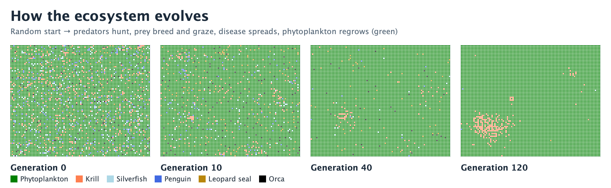
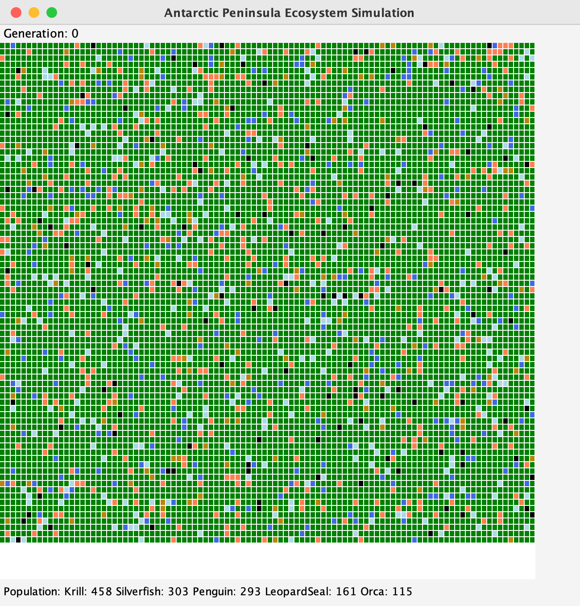
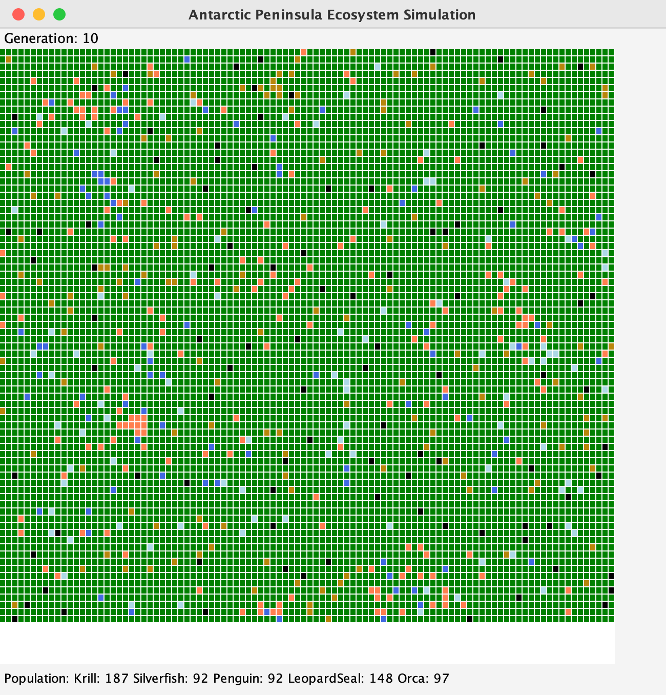
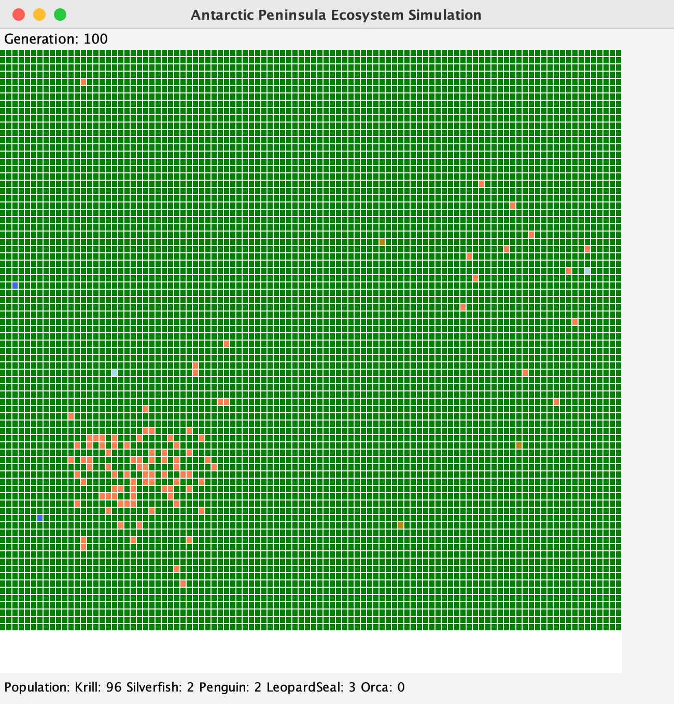
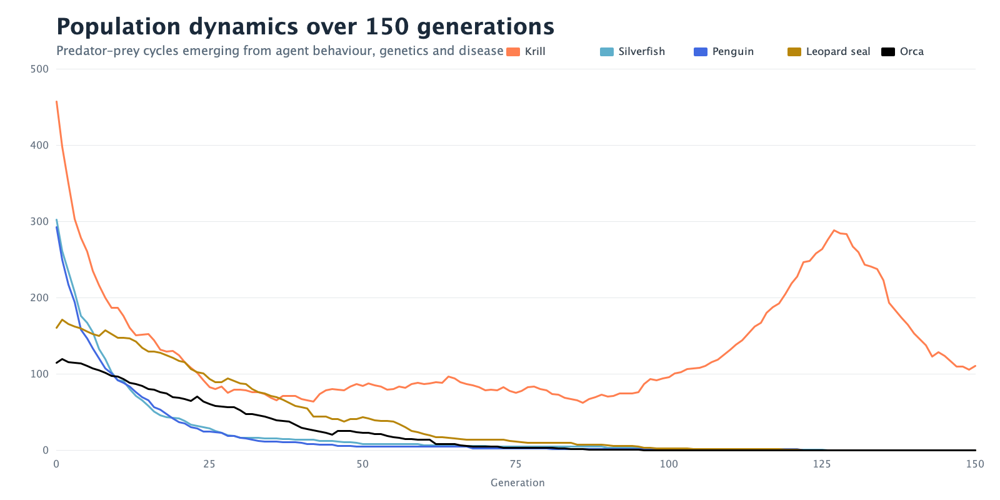
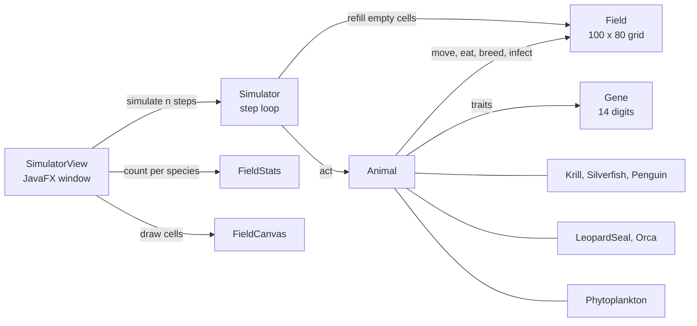

# Antarctic Ecosystem Simulation

An agent-based predator–prey model of an Antarctic Peninsula food web, written in Java with a JavaFX view. Five animal species and phytoplankton live on a 100 × 80 grid; each animal carries a 14-digit gene that sets its life cycle, and those genes are inherited, crossed over and mutated from one generation to the next.



## Problem and purpose

Classic predator–prey exercises use fixed constants for every animal: one breeding age, one life span, one litter size per species. That makes the population curves easy to tune but removes the interesting question, which is what happens when the traits themselves are under selection.

This project replaces those constants with a heritable gene, adds sexual reproduction and a contagious disease, and lets the food web run. It was built to practise inheritance and polymorphism in a model where the class design has visible consequences.

## Project status

**Academic coursework, complete.** Written individually for *Programming Practice and Applications* (4CCSAPPA) at King's College London, February 2026, by extending a starter project supplied by the module. It is a teaching-scale simulation, not a calibrated ecological model. See [Authorship](#authorship-and-acknowledgements) for exactly what was supplied and what was added.

## Screenshots

| Generation 0 | Generation 10 | Generation 100 |
|---|---|---|
|  |  |  |

The window screenshots are from the running application. Runs are seeded, and the counts shown at generation 10 (krill 187, silverfish 92, penguin 92, leopard seal 148, orca 97) are the same counts the headless check reproduces in [docs/evidence/population-seed-1111.csv](docs/evidence/population-seed-1111.csv).



An animated run is in [docs/screenshots/simulation-run.gif](docs/screenshots/simulation-run.gif).

## Main features

- **Six-entity food web.** Phytoplankton → krill, silverfish, penguin → leopard seal, orca. Both predators hunt all three prey, so they compete for one food supply ([`LeopardSeal.java`](src/LeopardSeal.java), [`Orca.java`](src/Orca.java)).
- **Heritable genes.** A 14-digit gene decodes to breeding age, life span, breeding probability, litter size, disease probability and metabolism ([`Gene.java`](src/Gene.java)).
- **Sexual reproduction.** Animals are male or female; a female breeds only with an adjacent male of the same species that has reached breeding age. Offspring take digits 0–6 from the mother and 7–13 from the father, then each digit mutates by ±1 with 20 % probability ([`Animal.java`](src/Animal.java)).
- **Disease with three transmission routes.** Spontaneous infection scaled by the gene's disease probability, contact spread to adjacent animals of the same species, and spread from the carcass when an infected animal dies.
- **Plants as first-class entities.** Phytoplankton occupy every cell not held by an animal, feed prey that move onto them, spread slowly, and regrow wherever an animal dies ([`Phytoplankton.java`](src/Phytoplankton.java)).
- **Deterministic runs.** One shared, fixed-seed random source means a run can be repeated exactly.

## Technology stack

| Technology | Role |
|---|---|
| Java 21 | Simulation model and application code. No build tool: the project is 16 classes in the default package, as BlueJ expects. |
| JavaFX 23 | The grid view (`Canvas`) and labels. The model itself only uses `javafx.scene.paint.Color`. |
| Bash | Two small scripts to compile, run and check without an IDE. |
| GitHub Actions | Compiles the sources and runs the headless checks on each push. |

## Architecture



Each step, every entity acts once (age, burn energy, progress disease, breed, then move and eat), dead animals are removed, newborns are added, and any empty cell is refilled with phytoplankton. More detail is in [docs/design-notes.md](docs/design-notes.md).

## Quick start

Requirements: a JDK (21 tested) and JavaFX (23 tested).

If your JDK does not bundle JavaFX, point `JAVAFX_LIB` at a folder containing the `javafx-*.jar` files: the `lib` folder of an [OpenJFX SDK](https://openjfx.io), or `Contents/Java` inside a BlueJ installation.

```bash
export JAVAFX_LIB=/path/to/javafx-sdk/lib
```

Open the window and run 200 generations:

```bash
scripts/run.sh 200
```

Without a number the window opens at generation 0 and waits, which is how it behaves in BlueJ. To use BlueJ instead, open the `src` folder as a non-BlueJ project, right-click `SimulatorView`, choose *Run JavaFX Application*, then call `simulate(200)` on the object.

## Example workflow

1. Run `scripts/run.sh 150`.
2. At generation 0 the grid is a random scatter: about 6 % krill, 4 % silverfish, 4 % penguin, 2 % leopard seal and 1.5 % orca, with phytoplankton everywhere else.
3. Over the first 25 generations prey numbers fall sharply as predators feed and the first random genes prove unviable.
4. With fewer prey, both predator species starve and decline.
5. Once predators are scarce, the krill population recovers and peaks around generation 125.

The population line at the bottom of the window shows the counts at every step.

## Engineering decisions

| Decision | Why | Trade-off |
|---|---|---|
| Phytoplankton extends `Animal` | The step loop, the grid and the statistics all work on one type, so plants need no special cases there. | A plant inherits a gene, a sex and a food level it never uses. A separate `Entity` supertype would be cleaner. |
| Two kinds of "free cell" on `Field` | Animals may move onto phytoplankton; phytoplankton may only spread into truly empty cells. | Callers must choose the right query. |
| Gene stored as an `int[14]` | It mirrors the brief's digit-string format directly, so crossover is an array copy and mutation is ±1 on a digit. | Decoding happens on every trait read. |
| Clamp after random generation and after mutation | Guarantees decoded traits always stay in the specified ranges. | Clamping rewrites digits, so a child's digits are not always within ±1 of its parents'. |
| Spontaneous infection scaled by 0.02 | Applying the raw gene probability (up to 0.5 per step) wipes out every species in a few steps. | The scale factor is a tuning constant, not a measured value. |
| One shared, seeded `Random` | Runs are reproducible, which is what makes the headless check and the evidence file possible. | No run-to-run variety unless the seed is changed in `Randomizer`. |

## Testing and evaluation

```bash
scripts/check.sh
```

This compiles the sources and runs [`test/SimulationCheck.java`](test/SimulationCheck.java) without opening a window. It checks that:

- across 5,000 generations of crossover and mutation, every decoded trait stays inside its specified range;
- offspring inherit the female half and the male half of the gene as specified;
- for 100 steps on the full grid, every cell is occupied after each step and no dead entity is left on the grid.

To regenerate the population data behind the chart:

```bash
scripts/check.sh --csv 150 > docs/evidence/population-seed-1111.csv
```

Not covered: the JavaFX view, the per-species hunting and feeding rules, and disease spread have no automated tests. They were checked by running the application.

## Limitations and roadmap

**What the model does today**

- The ecosystem does not reach a stable cycle. With the fixed seed, orcas are extinct by generation 100, and leopard seals, silverfish and penguins by generation 150; only krill persist. Random first-generation genes leave many animals unable to breed before they die, which predators never recover from.
- The prey and predator classes repeat most of their `act`, `findFood` and `giveBirth` logic.
- The grid size, creation probabilities and seed are constants in the source.
- The chart is produced outside the application from the exported CSV.

**Possible next steps**

- Move the shared behaviour into `Prey` and `Predator` superclasses.
- Constrain first-generation genes to viable ranges and tune food values so predators can persist.
- Add an in-window population chart and controls for speed, seed and grid size.

## Authorship and acknowledgements

Written by **Fakhriyya Vazirova** as individual coursework.

The starting point was the *foxes-and-rabbits* project by David J. Barnes and Michael Kölling (*Objects First with Java*), in a JavaFX version adapted for the module by Jeffery Raphael. Original authors are credited in each file's header.

| Files | Origin |
|---|---|
| `Gene`, `Krill`, `Silverfish`, `Penguin`, `LeopardSeal`, `Orca`, `Phytoplankton` | New in this project |
| `Animal`, `Simulator` | Supplied, then largely rewritten (genetics, sex, disease, food levels, plant regrowth) |
| `Field`, `FieldStats`, `SimulatorView` | Supplied, then modified |
| `Counter`, `FieldCanvas`, `Location`, `Randomizer` | Supplied, with minor edits |
| `test/SimulationCheck.java`, `scripts/`, CI workflow, `--steps` launch option | Added when preparing this repository |

The disease model is loosely based on avian cholera (*Pasteurella multocida*) outbreaks in seabird colonies.

No licence has been chosen for this repository. Changes made while preparing it are listed in [docs/repository-cleanup.md](docs/repository-cleanup.md).
